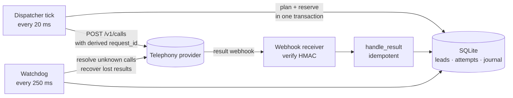
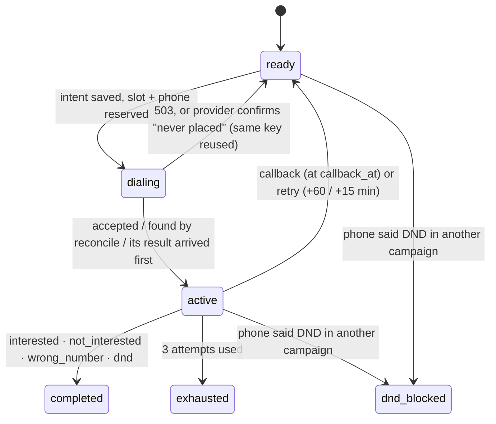

# Switchboard

**A crash-proof outbound-call dispatcher.** It decides who to call and when, places calls through a
telephony provider, processes the results, and **survives `kill -9` at any moment without
double-dialling, losing a lead, or breaking a calling rule.**

Built for the Agentic Universe Junior SDE take-home, Assignment B (Durable Campaign Dispatcher).
The original brief is in [`docs/ASSIGNMENT.md`](docs/ASSIGNMENT.md) and
[`assignment-b-workflow/README.md`](assignment-b-workflow/README.md).

### Results against the provider's own grader

| Run (600× speed, all provider failures on) | Process deaths | Rule violations | `final_state.csv` vs provider |
|---|---|---|---|
| seed 7, no failures (baseline) | 0 | **0** | ✅ 200 / 200 match |
| seed 7, 6 hard kills **+ 14 crashes injected at the most dangerous lines** | **20** | **0** | ✅ 200 / 200 match |
| seed 2026 (unseen), 4 hard kills | 4 | **0** | ✅ 200 / 200 match |

Every run was also checked by an independent re-implementation of all 9 rules (see below):
**9 / 9 PASS** each time.

---

## What makes it stand out

### 1. Double-dialling is impossible by construction, not by luck
Every call carries an idempotency key, and the provider places at most one call per key. Most
designs use a random UUID and hope it was saved before the crash. Switchboard **derives** it:

```
request_id = sb-<run>-<campaign>-<lead>-a<attempt_no>      attempt_no = accepted calls + 1
```

The key is a pure function of saved state, so a process that restarts after *any* crash
regenerates **the exact same key** for the same attempt. Re-sending it can only return the call
that already exists. **At most one call per attempt can ever exist.**

### 2. Save first, dial second, and treat "unknown" as busy
Before any network request, one atomic `BEGIN IMMEDIATE` transaction checks free capacity,
**reserves the tenant slot and the phone number**, and records the intent. Until the provider
confirms otherwise, that intent counts as a live call. A crash at any later line therefore leaves
the system *over*-reserved (a few milliseconds of lost throughput), never *under*-reserved (a
violation).

### 3. Ambiguity is a state, never a guess
A `504` means "the call may or may not have been placed". Switchboard doesn't guess. It asks the
provider (`GET /v1/calls?request_id=…`): if the call is found it is adopted, never re-dialled;
on a 404 the intent is released and the same key is reused. It only asks once the intent is old
enough that no request of ours can still be in flight. And if a result ever arrives for a call we
believed unplaced, we accept it, because evidence beats assumptions.

### 4. Crash points: we kill it on the worst possible line, on purpose
The brief says to ask *"what if my process dies right here?"* at every line between picking a
lead and recording the provider's answer. Each of those lines is a **named crash point** that
can hard-exit the process (`os._exit`, which is what `kill -9` does):

| Crash point | The process dies… |
|---|---|
| `after_intent_commit` | after reserving the slot, before sending the call request |
| `after_provider_reply` | after the provider accepted, before we recorded it |
| `after_webhook_verified` | after receiving a signed result, before applying it |
| `after_result_commit` | after applying a result, before telling the provider "OK" |
| `mid_reconcile` | after asking the provider about an unknown call, before recording the answer |

Random kills rarely land on these lines. Crash points make sure they do.

### 5. One command reproduces the graders' whole test
```bash
python -m solution.switchboard chaos --seed 7 --kills 6 --crashpoints 0.01
```
It starts the mock provider, runs the dispatcher, **hard-kills it repeatedly**, restarts it until
every lead is final, and prints a scorecard: the provider's violation count, a row-by-row diff of
`final_state.csv` against the provider, and our own audit.

### 6. Two-key verification: an independent auditor
[`audit.py`](solution/switchboard/audit.py) re-checks **all 9 rules (R1–R9)** from the raw call
records, with its own window and overlap logic. It shares **no code** with the dispatcher's rule
engine, so a bug in the dispatcher would have to be written twice to go unnoticed.

### 7. It adapts to a slow provider
The provider checks the calling window when the request *arrives*, not when we decided to send
it. Switchboard measures every request's round-trip time and **stops starting calls that much
earlier before closing time** (2× the slowest recent round trip). This came from a real bug: see
[What I found](#what-i-found-along-the-way).

### 8. Callbacks on time: it holds a slot free
When a customer says "call me back at 3 pm", that call should start at 3 pm, not whenever a slot
frees up. If a callback is due within the next 7 simulated minutes (about one call's maximum
length), the planner **stops giving that tenant's last free slots to other calls**, so the
callback finds one waiting.

### 9. A history that can't be rewritten
Every decision and observation is written to an **append-only journal**. The database itself
refuses `UPDATE` and `DELETE` on it (SQL triggers). You can replay any lead's full story across
process restarts:
```bash
python -m solution.switchboard journal --lead c_acme_renewals/ren_0007
```

### 10. A live dashboard
While it runs, open **http://127.0.0.1:8200/**: busy and held call slots per tenant, progress
bars per campaign, open/closed windows, upcoming callbacks, recovery counters (504s resolved,
duplicate webhooks ignored, lost webhooks recovered, restarts), and the live journal.

### Also
- **Epoch fencing:** if the provider itself restarts, the old state is archived automatically
  instead of being mixed with the new run.
- **Signed webhooks:** HMAC-SHA256 over the raw body with a constant-time comparison; forged or
  tampered results are rejected and logged.
- **Privacy:** customer names are never read into the system; phone numbers are masked in logs
  and on the dashboard.

---

## How it works



**A lead's lifecycle**



### The rules it enforces
| | Rule |
|---|---|
| R1 | Start calls only inside the campaign window **and** 09:00–21:00 IST |
| R2 | Never exceed a tenant's concurrent-call limit (shared across its campaigns) |
| R3 | Never two live calls to the same phone number |
| R4 | At most 3 accepted calls per lead |
| R5 | Wait 60 min after `no_answer` / `busy`, 15 min after `failed` |
| R6 | Callbacks never early, as soon as possible after; callbacks > retries > fresh leads |
| R7 | Stop after a terminal disposition |
| R8 | DND blocks that phone number in every campaign |
| R9 | Every lead ends `completed`, `exhausted` or `dnd_blocked` |

---

## Quick start

```bash
python -m venv .venv
source .venv/bin/activate              # Windows: .venv\Scripts\activate
pip install -r requirements.txt

pytest                                  # 58 tests, ~1 s, no provider needed
```

**Normal run** (two terminals):
```bash
cd assignment-b-workflow && python -m mock_telephony     # 1. the mock provider
python -m solution.switchboard run                        # 2. from the repo root
```
It writes `final_state.csv`, checks it against the provider, and prints the provider's report.
Kill it at any time and run the same command again: it resumes where it stopped.

**All commands**
| Command | What it does |
|---|---|
| `python -m solution.switchboard run` | Dispatch until every lead is final, then write `final_state.csv` |
| `python -m solution.switchboard chaos` | The kill -9 torture test plus a scorecard (`--seed`, `--kills`, `--crashpoints`) |
| `python -m solution.switchboard audit` | Re-prove R1–R9 from our own records |
| `python -m solution.switchboard verify` | Compare our final states with the provider's |
| `python -m solution.switchboard journal` | Show the journal (`--lead campaign/lead` for one lead's story) |

---

## Project layout

```
solution/switchboard/
├── schedule.py    calling-window maths (pure, no I/O)
├── policy.py      the rules: what happens after a call, who to call next (pure, no I/O)
├── engine.py      the only code that changes state: dial, reconcile, apply results, watchdog
├── store.py       SQLite schema, atomic transactions, append-only journal
├── app.py         webhook receiver (HMAC), /status, dashboard
├── audit.py       independent re-check of R1–R9
├── crash.py       named crash points
├── chaos.py       kill -9 harness + scorecard
└── dashboard.html live dashboard
solution/tests/    58 tests: windows, rules, and engine failure scenarios with a fake clock
```

The rules live in **pure functions** (`schedule.py`, `policy.py`) that take the time as an
argument, so every rule is tested with a fake clock in milliseconds instead of waiting on the
mock.

---

## What I found along the way
The first full run produced **10 calling-window violations**. Our records showed calls "lasting"
50 simulated minutes, but the mock never lets a call last longer than 6.5, so the provider itself
was freezing. Profiling found the cause: on Windows, creating an HTTP client takes ~450 ms (it
loads a certificate bundle), and the mock creates one **per webhook**. At 600× speed each freeze
is ~4.5 simulated minutes, so calls we sent at 18:59 arrived at 19:04.

- **The fix in the dispatcher:** the latency-aware window guard (feature 7). It stays safe even
  against a slow provider.
- **The fix in the test setup:** on Windows, `chaos` gives the mock a one-certificate
  `SSL_CERT_FILE`, without touching the mock's code.

---

## More detail
- [`SUBMISSION.md`](SUBMISSION.md): design, every decision and its alternative, failure modes,
  testing, known limits, and what I'd do next (including 1M leads/day across 50 tenants).
- [`AI_USAGE.md`](AI_USAGE.md): how AI tools were used, and how the result was verified.
