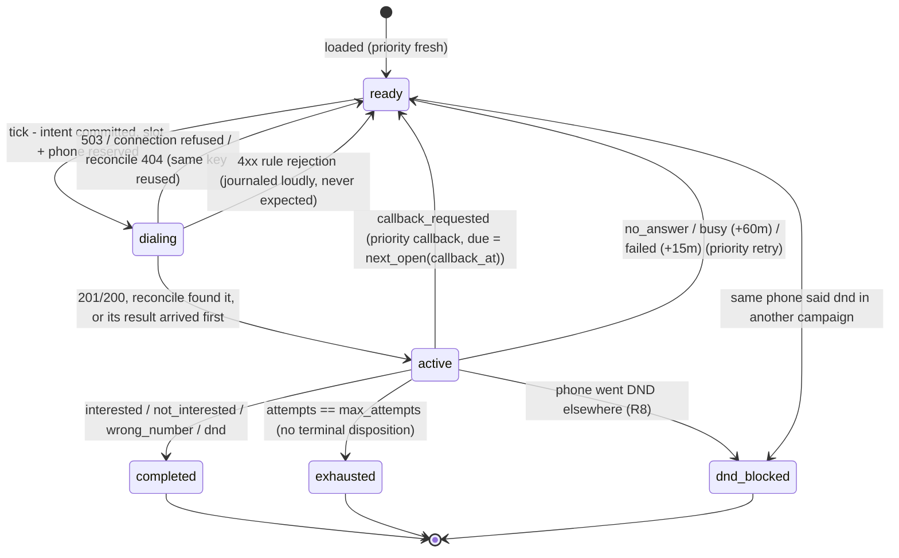

# Submission

## Candidate
- **Name:** Pratham Ahuja
- **Assignment chosen:** B (Workflow): **Switchboard**, a crash-proof campaign dispatcher
- **Time spent (honest estimate):** _fill in_

## How to run
```bash
# setup (Python 3.11+)
python -m venv .venv
source .venv/bin/activate            # Windows: .venv\Scripts\activate
pip install -r requirements.txt      # nothing beyond the provided deps (fastapi, uvicorn, httpx, pytest)

# tests: pure scheduling/policy + engine failure scenarios, fake clock, no mock needed (<1 s)
pytest

# a normal run: two terminals
cd assignment-b-workflow && python -m mock_telephony         # terminal 1
python -m solution.switchboard run                            # terminal 2, from the repo root
#   -> writes ./final_state.csv, then cross-checks it against /admin/leads and prints /admin/report
#   -> live dashboard while it runs: http://127.0.0.1:8200/   (JSON: /status)
#   -> kill -9 it at any time and run the same command again: it resumes

# the whole grading scenario in one command: starts its own mock, hard-kills us repeatedly,
# restarts us until done, then prints a scorecard (provider verdict + our own audit)
python -m solution.switchboard chaos --seed 7 --kills 6 --crashpoints 0.01

# forensics
python -m solution.switchboard audit                          # re-prove R1-R9 from our own ledger
python -m solution.switchboard journal -n 50                  # tail the append-only journal
python -m solution.switchboard journal --lead c_acme_renewals/ren_0007   # one lead's whole life
```
State lives in `solution/.state/switchboard.db` (SQLite, gitignored). Chaos runs go to
`solution/.runs/<timestamp>/` (logs, DB, `final_state.csv`, `scorecard.txt`).

## Design

**One process, three cooperating loops on one asyncio event loop, all state in SQLite.**

```
            ┌───────────────── switchboard process ─────────────────┐
 provider ──┤ POST /webhooks/telephony ─► handle_result ─┐           │
 (mock)     │                                           ▼           │
            │  dispatcher tick (20 ms) ──► BEGIN IMMEDIATE ──► SQLite (WAL)
            │      plan_dispatch (pure)        intent rows      leads / attempts
            │      └─► place(): POST /v1/calls                  journal (append-only)
            │  watchdog (250 ms) ─► reconcile unknown intents   dnd_phones
            │                     ─► poll calls missing a result
            └────────────────────────────────────────────────────────┘
```

I picked a DB-backed state machine over Temporal deliberately. The interesting failures here are
at the boundary with the carrier (504s, lost webhooks, a crash between "decided" and "dialled").
Temporal makes *our* workflow code durable, but an activity that POSTs to the carrier still needs
an idempotency key and a reconcile step, and that is exactly what this design is built on. Doing
it explicitly keeps every safety argument visible in about 300 lines.

### At-most-once dialling: three ideas

1. **The idempotency key is derived, not random.**
   `request_id = sb-<run>-<campaign>-<lead>-a<attempt_no>`, where `attempt_no = accepted calls + 1`.
   It's a pure function of durable state, so any process that ever decides to make attempt #2 for
   a lead computes the same key. The provider places at most one call per key, so **at most one
   call per attempt can ever exist**: across retries, 504s, crashes and restarts. `<run>` is a
   hash of the provider's epoch (see "epoch fencing").
2. **Write-ahead intent, with slots reserved.** Before any network I/O, one `BEGIN IMMEDIATE`
   transaction (a) reads live calls per tenant and per phone, (b) runs the pure planner, and
   (c) writes the chosen `intent` rows. An `intent` counts as a live call for R2/R3 until we learn
   otherwise. So a crash at any later point leaves us **over-reserved (safe), never
   under-reserved**.
3. **Unknown is a state, not a guess.** After a 504, a timeout or a crash, the intent stays
   `intent`. Only the provider can resolve it: `GET /v1/calls?request_id=…` → found means
   adopted as accepted (never re-dialled); 404 means released, and the *same key* is reused next
   time. We only ask once the intent is ≥1.5 real s old, so no POST of ours can still be in
   flight. And if a result ever shows up for an attempt we thought unplaced, we accept it
   ("evidence beats assumptions") and journal a `late_placement`.

### Lead state machine


The final-state precedence `completed > exhausted > dnd_blocked` is the order of the checks in
`policy.after_result`. An attempt row has its own small lifecycle:
`intent → accepted → ended`, `intent → not_placed → intent` (same key), `intent → rejected`.

### Code map (`solution/switchboard/`)
| File | Role | I/O? |
|---|---|---|
| `schedule.py` | window maths: `is_open`, `next_open` (IST, days, regulatory intersection, end guard) | pure |
| `policy.py` | `after_result` (R4-R9) and `plan_dispatch` (R1-R3, R6 priority, callback slot holding) | pure |
| `engine.py` | the only code that changes state: tick, place, reconcile, handle_result, watchdog | DB + HTTP |
| `store.py` | SQLite schema, `BEGIN IMMEDIATE` transactions, append-only journal (triggers) | DB |
| `app.py` | webhook (HMAC over raw bytes, constant-time compare), `/status`, dashboard | HTTP |
| `audit.py` | **independent** re-implementation of R1-R9 that checks our ledger | DB |
| `crash.py` | named crash points: deterministic `os._exit` at each dangerous line | – |
| `chaos.py` | one-command kill -9 harness + scorecard | processes |

### What makes this different
- **Crash points, not just random kills.** The hint says to ask "what if my process dies right
  here?" at every line between picking a lead and recording the provider's answer. Each such line
  is a named crash point (`after_intent_commit`, `after_provider_reply`, `after_webhook_verified`,
  `after_result_commit`, `mid_reconcile`). `chaos --crashpoints p` arms all of them, so deaths
  land exactly on the dangerous lines, on top of the external hard kills at random times.
- **Two-key verification.** `audit.py` re-checks R1-R9 from the raw facts in our ledger with its
  own window/overlap logic, sharing no code with `policy.py`/`schedule.py`. A bug in the
  dispatcher would have to be duplicated in the auditor to go unnoticed. The chaos scorecard
  shows both verdicts (the provider's and ours) side by side.
- **Callback slot holding (R6 lateness).** If a callback falls due within 7 sim-minutes (≈ one
  call's maximum length), the planner stops giving that tenant's last slots to retries and fresh
  leads, so the callback finds a free slot at its due time instead of waiting for one to end.
- **Latency-aware window guard (R1).** The provider judges the window when our POST *arrives*.
  We don't start calls closer to window close than 2× the slowest recent POST round trip (in sim
  time, floor 20 s, cap 15 min). Found the hard way; see below.
- **Epoch fencing.** The DB remembers which provider lifetime it belongs to. If the provider was
  restarted, the old DB is archived and a fresh run begins; the old keys could never collide
  anyway because `<run>` changes.
- **Append-only journal, enforced by the database.** `UPDATE`/`DELETE` on `journal` raise.
  `journal --lead X` prints a lead's full story across process lives (each line carries the pid).
- **PII minimisation.** `customer_name` is never read into our state. Phones are stored (we must
  dial them) but masked in logs and the dashboard.

## Decisions & assumptions

| Decision | Why | Alternative considered |
|---|---|---|
| SQLite (WAL, `synchronous=NORMAL`) instead of Temporal/Postgres | Zero setup; `BEGIN IMMEDIATE` gives the atomic "check capacity + reserve" step; WAL commit survives `kill -9` (only power loss could drop the last commit) | Temporal: still needs the same key/reconcile logic at the carrier boundary |
| Derived (not random) `request_id` per attempt | Re-deriving the key after a crash makes double-dial impossible by construction, even if the intent row itself were lost | Random UUID stored before POST: safe only if the store write always precedes the POST |
| Count unresolved `intent`s as live calls | Under-counting = violation; over-counting = a few ms of lost throughput | Optimistically ignoring them (unsafe after a 504) |
| Only release an intent on a provider 404, ≥1.5 real s after it was written | Guarantees no POST of ours is still in flight when we conclude "never placed" | Release immediately on 504 (unsafe: "placed but response lost" is a real path) |
| `ConnectError` = not placed; read timeout = unknown | No TCP connection means the request never arrived; a timeout after sending proves nothing | Treat every transport error as unknown (safe but slower) |
| Our POST timeout is 10 s | The provider's own 504 path sleeps 2 s; a shorter timeout would *create* ambiguity | – |
| Retry/callback timing measured from the provider's `ended_at` / `callback_at` | R5/R6 say so; our own receive time is later and would drift | – |
| Dial exactly at `callback_at` / `ended_at + gap`, never inside the provider's 120 s skew allowance | The spec says "don't call before it"; the grace is for clock skew, not for us to use | Dialling 60 s early would get lateness to 0 but break R6's wording |
| Effective window = campaign ∩ regulatory, minus the end guard | R1 needs both; starting a call in the last seconds is not worth the risk | – |
| Callbacks outside the window go at the next opening of the **campaign** window | Matches R6 and how the provider measures lateness | – |
| A 503 backs off 0.2 real s and moves the lead behind leads due now; a confirmed-unplaced intent keeps its queue position | Don't hammer a struggling provider; don't penalise a lead for our crash | – |
| Fresh leads interleave across a tenant's campaigns by file position | Fairness: one campaign can't starve the other under a shared limit | Strict campaign order |
| A `completed` result with no/unknown disposition is retried after the longest gap, never dropped | R9: no lost leads, even on unexpected input | Treat as terminal |
| Unknown/duplicate webhooks get 200 | Redelivery cannot change anything; a non-2xx would only cause retry noise | 4xx |
| Bad signature gets 401 and is journaled | Never act on unsigned input | – |
| Process exits after writing `final_state.csv` (`--linger` keeps the dashboard) | "Runs until every lead reaches a final state, then writes final_state.csv" | Run forever |

## Failure modes considered

| What happens | How it's handled | Test |
|---|---|---|
| 503 | Intent → `not_placed`; same key re-POSTed after a short backoff; not counted as an attempt | `test_503_…` |
| 504, call **was** placed | Reconcile finds it → adopted; never re-dialled | `test_ambiguous_504_that_was_placed…` |
| 504, call **not** placed | Reconcile 404 → released → same key re-POSTed | `test_ambiguous_504_that_was_not_placed…` |
| Webhook before the 201 | Result handler accepts the `intent` first, then applies; the late 201 is a no-op | `test_webhook_before_the_201_is_read` |
| Duplicate webhook | Attempt is already `ended` → journaled `duplicate_result`, nothing changes | `test_duplicate_webhook_is_harmless` |
| Lost webhook | Watchdog polls `GET /v1/calls/{sid}` for accepted calls ≥1 sim-min old, every 1 real s | `test_lost_webhook_…` |
| Webhook while we're down | Provider gives up after ~7 s; on restart every `accepted` row is polled | chaos runs |
| Crash after intent, before POST | Slots stay reserved; reconcile 404 releases; same key reused | `test_crash_between_intent_and_post…` |
| Crash after provider accepted, before we recorded | Reconcile finds the call → adopted | `test_crash_after_provider_accepted…` |
| Crash after applying a result, before replying 2xx | Provider redelivers → duplicate → ignored | crash point `after_result_commit` |
| Restart while a POST of the dead process may be in flight | Intents younger than 1.5 real s are not reconciled | `test_young_intent_is_not_reconciled…` |
| Forged or tampered webhook | HMAC over raw bytes, `compare_digest`; 401 | `test_webhook_signature_is_verified` |
| Provider restarted under us | Epoch fencing archives the stale DB and starts a fresh run | manual |
| Slow or stalled provider near window close | Latency-aware end guard | found in a real run (see Results) |
| Two dispatchers started by accident | The second can't bind :8200 and exits before dispatching | manual |

**Not handled / known limits**
- **Two dispatchers at once (horizontal scale).** Planning and reservation are already safe across
  processes (`BEGIN IMMEDIATE`). But the in-flight guard for reconciliation is per process, so a
  second process could reconcile the first one's intent while its POST is in flight. I'd fix this
  with an owner lease on intents (`owner_pid` is already stored) before claiming this stretch.
- A POST stuck in the network for >1.5 real s that then lands after we released its intent. The
  late placement is still detected and adopted (the same key is reused, and any result for it is
  accepted), but it could briefly overlap a slot we gave away. Very unlikely on localhost.
- Power loss (not process death) could lose the last committed transaction under
  `synchronous=NORMAL`. `FULL` fixes it at a throughput cost.

## Testing
`pytest` runs 58 tests in under 1 s. None of them waits on the mock.
- `test_schedule.py`: window boundaries (`[start, end)`), weekdays, regulatory clipping, end
  guard, next opening across close / weekend / Sunday, UTC→IST, naive datetimes refused, the real
  fixture windows.
- `test_policy.py`: every `after_result` branch including precedence, retry gaps, callbacks
  inside/outside windows, callbacks on the last attempt. Planner: R6 priority order, oldest
  first, tenant limit shared across campaigns, tenants independent, same phone across campaigns,
  DND, not-yet-due, closed window, callback slot holding (and that a far-off callback doesn't
  hold a slot).
- `test_engine.py`: the engine against an in-memory fake provider with scriptable 503 / 504
  (placed and unplaced) / connection refused, a fake clock, and a real SQLite file. A simulated
  crash is a brand-new `Engine` + `Store` on the same file.
- **End to end:** `python -m solution.switchboard chaos` (results below).

Not unit-tested: uvicorn/httpx wiring (covered by the chaos runs), and multi-process dispatch.

## Results
_Pasted from `chaos` scorecards; see `solution/.runs/*/scorecard.txt` after a run._

All runs at 600×, full failure injection (`--failure-scale 1`), on Windows 11, Python 3.12.

| Run | Process lives | violation_count | final_state vs /admin/leads | Self-audit R1-R9 | Callback lateness p50 / p90 / max |
|---|---|---|---|---|---|
| seed 7, no kills, failure scale 0 (baseline) | 1 | **0** | MATCH 200/200 | all PASS | 0.3 / 0.7 / 5.5 min |
| seed 7, 6 hard kills **+ crash points armed (p=0.01)** | **21** (6 kills, 14 injected crashes) | **0** | MATCH 200/200 | all PASS | 8.9 / 37.1 / 71.8 min |
| seed 2026 (unseen), 4 hard kills | 5 | **0** | MATCH 200/200 | all PASS | 0.3 / 10.4 / 20.7 min |

Full `/admin/report` summary of the 21-life run (seed 7):
```
violation_count           0
max_concurrency_seen      {'acme_insurance': 4, 'zen_retail': 3}
callback_lateness_minutes {'count': 64, 'p50': 8.9, 'p90': 37.1, 'max': 71.8}
webhooks                  {'lost': 13, 'delivered': 433, 'duplicates': 42, 'connect_errors': 111, 'gave_up': 2}
our ledger: 407 calls accepted, 20 ambiguous 504s reconciled, 27 503s retried,
            118 duplicate results ignored, 64 results recovered by polling, 0 provider rejections
```
`connect_errors: 111` and `gave_up: 2` are webhooks sent while we were dead. Both were recovered
by polling after restart. Callback lateness grows with the number of deaths: each restart costs
about 1–2 real seconds (about 10–20 sim-minutes at 600×) of not dialling. With no deaths the
median is 0.3 min. The 21-life run is deliberately extreme. The 5-life run (unseen seed) is
closer to the graders' scenario. A full run takes about 9 real minutes (Thu 17:30 → Mon morning in
sim time, because zen_winback doesn't dial at weekends).

**Something surprising I found.** My first end-to-end run had 10 `outside_calling_window`
violations, and calls "lasted" up to 50 sim-minutes when the mock caps them at 6.5. I profiled it:
on this Windows machine, constructing an `httpx.AsyncClient` takes about 450 ms (loading
certifi's CA bundle). The mock builds one **per webhook**, which blocks its event loop. At 600× that
freezes the provider for about 4.5 sim-minutes per webhook, so our POSTs reached it long after we
had decided to send them.
Two responses:
1. **Make the dispatcher robust to it:** the latency-aware window guard. Even against a stalling
   provider we won't start calls near the close.
2. **Make the dev environment honest:** on Windows, `chaos` starts the mock with an
   `SSL_CERT_FILE` holding one certificate (the webhooks are plain http, so it changes nothing but
   speed). The mock's code is untouched. On Linux this isn't needed.

## If I had another day
1. Owner leases on intents, then run two dispatchers against one DB in the chaos harness
   (horizontal-scale stretch).
2. Feed the callback-hold look-ahead from observed call durations instead of a fixed 7 minutes.
3. Property-based tests (Hypothesis) on `plan_dispatch`: random ready sets and capacities, assert
   R2/R3/R6 ordering invariants.
4. Postgres + `SELECT … FOR UPDATE SKIP LOCKED` for many workers; partition the tick by tenant.
5. **At 1M leads/day across 50 tenants:** the per-tick full scan of ready leads becomes an index
   range scan on `(state, eligible_at)` per tenant; one dispatcher shard per tenant group
   (concurrency limits are per tenant, so tenants are the natural shard key); webhooks into a
   durable queue rather than straight into the DB; the journal moves to an append-only event
   stream (Kafka) with the `leads` table as its projection; provider rate limits get their own
   token buckets.
